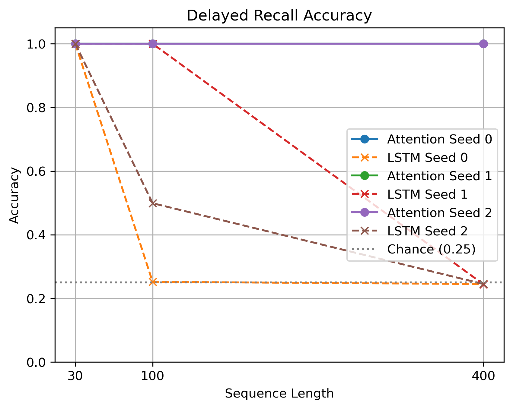

# Attention Against Recurrence
Attention built from scratch, then tested against recurrence, positions
and normalization on small tasks with known answers.

## Setup
python -m venv .venv
source .venv/bin/activate # Windows: .venv\Scripts\activate
pip install -r requirements.txt

## Run
Open and run lab05.ipynb from top to bottom

## Prediction (written before running the mixed-length training)
What I expected for learned and sinusoidal positions at length 32, and why.

## Results
Verification: what matched PyTorch, and the parameter counts.
My scaled dot-product attention matched PyTorch with and without a causal mask for seeds 0, 1, and 2. My multi-head attention also matched PyTorch for self-attention, causal self-attention, and cross-attention.
The parameter counts were: 4224 for 1, 2, 4, and 8 heads.

Recall: accuracy per seed at each length, and the weight on step 0.
| Length | Seed | Attention Accuracy | Weight on Step 0 | LSTM Accuracy |
|---|---|---|---|---|
| 30 | 0 | 1.000 | 0.730 | 1.000 |
| 30 | 1 | 1.000 | 0.742 | 1.000 |
| 30 | 2 | 1.000 | 0.674 | 1.000 |
| 100 | 0 | 1.000 | 0.738 | 0.252 |
| 100 | 1 | 1.000 | 0.746 | 1.000 |
| 100 | 2 | 1.000 | 0.658 | 0.499 |
| 400 | 0 | 1.000 | 0.741 | 0.245 |
| 400 | 1 | 1.000 | 0.746 | 0.244 |
| 400 | 2 | 1.000 | 0.663 | 0.245 |
 
As seen in the graph above, attention achieved 100% accuracy across all lengths and seeds, while the LSTM became less reliable at longer lengths.

Positions: accuracy per seed at each length, before and after mixing lengths.
Stacks and timing: accuracy per seed, and the timing table.

## Conclusion
What attention removed, what it costs, and what these measurements
do and do not establish.

## Known limitations
Anything you are aware of that does not work, or that you would improve with more time.